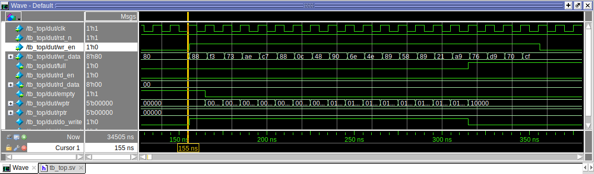

# Synchronous FIFO: RTL and Class-Based Verification Environment

A parameterized synchronous FIFO written in SystemVerilog, verified with a layered, class-based (non-UVM) testbench. The testbench uses a reference-model scoreboard and self-checks for corner-case coverage.

Simulated with **Questa FPGA Starter Edition**. The testbench avoids `randomize()`, constraints and covergroups (not available in the Starter Edition license) and uses `$urandom` instead.

> **Note:** This is a learning project. The RTL and testbench were drafted with AI assistance, then studied, simulated and extended by me as part of my path toward design verification.

## Design

`rtl/sync_fifo.sv`

| Parameter | Default | Description |
|---|---|---|
| `DATA_WIDTH` | 8 | Width of each FIFO entry |
| `DEPTH` | 16 | Number of entries (**must be a power of 2**) |

Key design points:

- Memory array of `DEPTH` entries with separate **write pointer** and **read pointer**.
- Pointers are `log2(DEPTH)+1` bits wide. The extra MSB is a "lap" bit used to tell full from empty:
  - `empty`: `wptr == rptr`
  - `full`: lap bits differ **and** address bits are equal
- Wrap-around happens naturally through pointer overflow (hence the power-of-2 depth requirement).
- Write when full and read when empty are **silently ignored** (no data corruption).
- Read data is **registered**: `rd_data` is valid one clock cycle after `rd_en`.
- Asynchronous active-low reset.

## Testbench architecture

`tb/tb_top.sv`

```
fifo_test
  └─ fifo_env
       ├─ fifo_generator ──mailbox──▶ fifo_driver ──▶ [ DUT ]
       └─ fifo_monitor   ──mailbox──▶ fifo_scoreboard ◀── [ DUT ]
```

| Component | Role |
|---|---|
| `fifo_txn` | One clock cycle of stimulus (`wr_en`, `rd_en`, `wr_data`) or an observed sample |
| `fifo_generator` | Creates transactions with configurable write/read probability (`$urandom`) and reset requests |
| `fifo_driver` | Drives the DUT through a clocking block; drives idle when no transaction is pending |
| `fifo_monitor` | Samples the interface just before every clock edge (what the DUT actually sees) |
| `fifo_scoreboard` | Cycle-accurate reference model (SystemVerilog queue). Checks `full`, `empty` and `rd_data` every cycle, including the registered-read behavior and reset values |
| `fifo_env` / `fifo_test` | Build and connect everything, run the scenarios |

The scoreboard does not trust the DUT's flags: expected `full`/`empty` are computed from the model's own occupancy.

## Test scenarios

- Reset and initial state
- Read from empty FIFO (underflow attempts)
- Fill to full and keep writing (overflow attempts)
- Simultaneous read and write while **full**, while **empty**, and in the middle
- Full drain
- Long random runs with different read/write biases (many pointer wrap-arounds)
- Reset with data inside, and reset while completely full
- Randomized-weight stress runs

At the end, the scoreboard also checks that the stimulus actually reached every corner case (FIFO became full, overflow/underflow attempted, simultaneous access at full/empty, pointer wrap-around, reset with data). If a corner was never hit, the test **fails** even if no data mismatch occurred.

## How to run

```
vlib work
vlog -sv rtl/sync_fifo.sv tb/tb_top.sv
vsim -c tb_top -do "run -all; quit"
```

Use a random seed for different stimulus on each run:

```
vsim -c tb_top -sv_seed random -do "run -all; quit"
```

## Results

```
================ FIFO TEST SUMMARY ================
  total cycles                  : 3442
  successful writes / reads     : 1332 / 1310
  max occupancy                 : 16 / 16
  full / empty cycles           : 589 / 875
  overflow attempts             : 388
  underflow attempts            : 619
  simultaneous wr+rd (normal)   : 634
  simultaneous, FIFO full       : 103
  simultaneous, FIFO empty      : 168
  reset with data               : 2
  *** TEST PASSED ***
===================================================
```

(The 22-entry difference between writes and reads is data discarded by the two resets that happened while the FIFO held data.)

## Waveforms

<!-- Replace the paths below with your own screenshots -->

| Scenario | Screenshot |
|---|---|
| Reset, write, read (1-cycle registered read latency) | `docs/waveforms/basic_write_read.png` |
| FIFO becoming full, extra write ignored, lap bit toggling | `docs/waveforms/full_flag.png` |
| Simultaneous read/write while full | `docs/waveforms/simul_at_full.png` |



## Repository structure

```
.
├── rtl/
│   └── sync_fifo.sv
├── tb/
│   └── tb_top.sv
├── docs/
│   └── waveforms/
├── README.md
└── .gitignore
```

## Possible future work

- Fault-injection (mutation) runs to show the testbench catches RTL bugs
- SVA assertions for `full`/`empty` and pointer invariants
- First-word-fall-through (FWFT) read mode
- Asynchronous FIFO with Gray-code pointers and CDC verification
- UVM version of the environment
